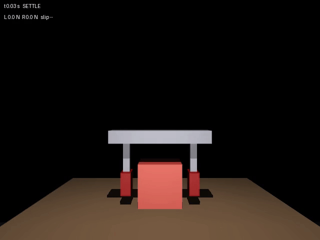

# GraspForge

GraspForge is a standalone MuJoCo application for developing, running, and evaluating contact-rich parallel-gripper experiments.

## Showcase

The gripper closes around the cube, lifts it, and holds it through a disturbance.




## Why “GraspForge”?

**GraspForge** combines grasp manipulation with a forge—a place to build and refine robust controllers through repeatable simulation.

The current release provides a complete vertical grasp pipeline:

- a free-body cube, table, lift axis, mirrored finger slides, touch sensors, and named cameras;
- contact extraction with local-to-world force conversion and friction utilization;
- a guarded `SETTLE → CLOSE → PRELOAD → LIFT → HOLD` controller;
- PI fingertip-force control, minimum-jerk lift motion, actuator clipping, and anti-windup;
- controlled external disturbances through `xfrc_applied`;
- deterministic seeded trials over pose, friction, and disturbance variation;
- success evaluation, replayable NPZ logs, strict JSON metrics, plots, and video rendering;
- managed video and experiment artifact lifecycles;
- a deterministic pytest regression suite.

## Status

Version: `0.1.0`

Current verification:

- the pytest regression suite covers the controller, evaluation, and CLI;
- 20/20 default robustness seeds pass;
- the nominal grasp reaches `DONE` and lifts approximately 0.15 m;
- the nominal CLI run satisfies all force, penetration, slip, disturbance-buffer, and finite-state criteria;
- a two-seed CLI benchmark passes and records its configured threshold correctly;
- the project builds as a wheel with the MJCF asset included.

Verified reference artifacts are stored under `artifacts/reference/`. New runs are written under `artifacts/runs/`, which is intentionally ignored by Git.

## Project layout

```text
graspforge/
├── pyproject.toml
├── README.md
├── src/graspforge/
│   ├── assets/gripper.xml   # MuJoCo scene and named interfaces
│   ├── contacts.py          # model indexing and contact-force analysis
│   ├── controller.py        # observations, state machine, control, rollout
│   ├── evaluation.py        # criteria, trials, persistence, diagnostics
│   ├── scenarios.py         # reproducible physical inspection scenarios
│   ├── video.py             # replay saved episodes as video
│   ├── video_library.py     # manage scenario videos
│   ├── artifacts.py         # list and safely clean experiment runs
│   ├── cli.py               # application commands
│   └── __main__.py
├── tests/                   # pytest regression and application tests
└── artifacts/reference/     # verified reference outputs
```

The package is under `src/` so tests and scripts cannot accidentally import an uninstalled checkout as a different package.

## Environment and installation

Create a dedicated Conda environment and install the project in editable mode:

```bash
conda create -n graspforge python=3.11 pip
conda activate graspforge
cd graspforge
python -m pip install -e ".[dev]"
```

The project pins MuJoCo 3.11.0, the version verified with the regression suite.
The `dev` extra installs pytest and Ruff for development.

For subsequent sessions, activate the existing environment with `conda activate graspforge`.

Confirm the application and compiled model:

```bash
graspforge inspect
```

Expected dimensions are `nq=10`, `nv=9`, and `nu=3`.

## Run the application

Run the nominal disturbed grasp and write the episode plus diagnostics:

```bash
graspforge run
```

Include an offscreen final-state render:

```bash
graspforge run --render
```

Choose a different output directory or camera:

```bash
graspforge run --render --camera overview --output artifacts/runs/demo
```

Run the default 20-seed robustness benchmark:

```bash
graspforge benchmark
```

Run a smaller development benchmark:

```bash
graspforge benchmark --trials 5 --min-successes 5 --output artifacts/runs/smoke
```

Commands return a nonzero exit code when their success requirement is not met, which makes them suitable for CI or experiment automation. An explicit `--min-successes` greater than `--trials` is rejected; when omitted, the default is 18 successes or all trials if fewer than 18 are run.

By default each command creates a uniquely named directory under `artifacts/runs/nominal/` or `artifacts/runs/benchmark/`. An explicit output directory is also supported, but existing result files are never overwritten.

## Physical scenarios and video replay

Install the optional video encoder support:

```bash
python -m pip install -e ".[video]"
```

Generate and manage the standard video set with:

```bash
graspforge videos generate
graspforge videos list
graspforge videos clean
```

`generate` runs the nominal, overload, low-friction, disturbance, misaligned, missing-object, seeded, and squeeze-and-release scenarios. Videos and metadata are stored under `artifacts/runs/videos/`. Repeat the command to resume an interrupted run, keep up-to-date videos, and refresh videos when code, model, software, or rendering settings change. `clean` removes the managed videos and their metadata; unrelated files are left alone.

To generate only selected cases, or use a separate library directory:

```bash
graspforge videos generate --case nominal --case overload
graspforge videos generate --directory artifacts/runs/my-videos --fps 24
graspforge videos clean --directory artifacts/runs/my-videos
```

The cases are `nominal`, `overload`, `friction`, `disturbance`, `misaligned`, `missing`, `seeded`, and `squeeze-release`. Scenario videos use default settings. For customized experiments and saved episode logs, use `graspforge scenario`, for example:

```bash
graspforge scenario friction --friction 0.15
graspforge scenario disturbance --force 15
graspforge scenario misaligned --offset 0.015 --yaw 5
graspforge scenario seeded --seed 3
```

Friction sets the cube's sliding friction, force sets the world +Y push in newtons, and misalignment uses metres and degrees. Squeeze-and-release operates on a resting cube; it is not a pick-and-place task. Expected grasp failures are successful scenario executions; inspect the report for the outcome.

The library reconstructs recorded states without resimulating during rendering. Overlays show time, phase, touch forces, slip, and the push window. A working MuJoCo OpenGL context is required; headless machines need a suitable configured rendering backend. For a saved episode, `graspforge video PATH_TO_EPISODE` remains available. Numerical criteria remain the source of truth for evaluating experiments.

## Artifact lifecycle

List experiment runs, including their type, creation time, size, completion and protection status:

```bash
graspforge artifacts list
graspforge artifacts list --kind scenario
```

Cleanup previews selected runs by default. Use `--apply` to delete the same selection:

```bash
graspforge artifacts clean --older-than 30d --keep 5
graspforge artifacts clean --older-than 30d --keep 5 --apply
```

`--keep` preserves the newest matching runs before the age filter is applied. Use `--kind nominal`, `--kind benchmark`, or `--kind scenario` to narrow the selection. With no filters, cleanup selects all recognized runs under `artifacts/runs/`; without `--apply` this only previews them. To include a custom output directory, explicitly pass `--path PATH` (repeatable) to `list` or `clean`. Only manifest-backed run directories are managed. Files such as build products and Python caches are outside this command's scope.

To protect a run, create an empty `.graspforge-protected` file inside it. Cleanup reports an error and deletes none of the selected runs if any selected run has that marker, read-only or immutable files, or unrecognized contents. Reference artifacts under `artifacts/reference/` are always protected. Remove the marker or change permissions only when you intend to allow cleanup. An operating-system error during deletion can still interrupt a cleanup after earlier files were removed; the command reports that situation.

Managed videos have a separate lifecycle: `graspforge videos list` and `graspforge videos clean`. Video cleanup likewise reports protected files rather than silently skipping them. To protect an entire video library, put a `.graspforge-protected` file in that library directory. Unrelated files are preserved.

## Tests

After installing the `dev` extra:

```bash
python -m pytest -q
python -m ruff check .
python -m ruff format --check .
```

For a quicker run without the longer robustness test, use `python -m pytest -q -m "not slow"`.

The suite verifies model wiring, contact-frame mathematics, touch/contact agreement, controller behavior, deterministic replay, failure detection, robustness, scenario recording, video encoding, and artifact protection. Video encoding tests use a simulated renderer; rendering a real scene requires a working graphics context.

## Runtime architecture

`contacts.py` resolves every named MuJoCo ID and address once per model. Contact records copy MuJoCo-owned buffers so logged values remain stable after subsequent physics steps. Contact forces are returned by MuJoCo in the contact frame and converted with `frame.T @ f_local[:3]`.

`controller.py` owns the hybrid controller. Each rollout observes a forward-consistent state at time `t_k`, calculates and clips a command, records the command applied over `[t_k, t_k+1)`, advances physics, and calls `mj_forward` before the next observation. This alignment is part of the logging contract.

`evaluation.py` is deliberately separate from the controller. The controller decides whether its state machine completed; the evaluator independently decides whether the physical task met lift, hold, slip, force, penetration, disturbance-buffer, and numerical-health requirements.

`cli.py` is the application boundary. Library code does not parse arguments or assume an output directory. This keeps controller and evaluation functions reusable from notebooks, services, or future UI processes.

## Important invariants

Preserve these rules when extending the application:

1. Construct fresh `MjModel`, `MjData`, and controller instances for every seeded trial.
2. Resolve joint, sensor, body, geometry, and actuator addresses by name; never rely on coincidental integer ordering.
3. Read only `data.contact[:data.ncon]` and copy contact-backed arrays before storing them.
4. Treat MuJoCo contact-frame rows as world-space axes; contact-to-world force conversion uses the transpose.
5. Clear all six entries of `xfrc_applied` outside the disturbance window.
6. Log state and command at `t_k` before stepping, then run `mj_step` followed by `mj_forward`.
7. Keep trial sampling local to `np.random.default_rng(seed)` and preserve its draw order when reproducibility matters.
8. Never save object arrays in NPZ artifacts; files must load with `allow_pickle=False`.
9. Do not tune controller parameters per trial when reporting a robustness result.

## Data products

`manifest.json` records the run type, UTC creation time, model and source SHA-256 hashes, software versions, controller settings, success criteria, and run parameters. Benchmark sampling ranges and per-trial values are recorded in the metrics file.

`grasp_episode.npz` contains aligned time-series arrays and the terminal reason. Grasp episodes also include phase and actuator name tables, column documentation, and criteria values. The squeeze-and-release scenario records a smaller set of replay fields. All episode files are compressed and pickle-free.

`grasp_metrics.json` contains MuJoCo version information, sampling ranges, controller configuration, success criteria, and one record per seeded trial. Non-finite values are converted to JSON `null`.

`grasp_diagnostics.png` plots height, touch force, contact normal force, finger positions, applied controls, slip, phase boundaries, and the disturbance window.

`grasp_final.png` is optional because rendering requires a working OpenGL context.
